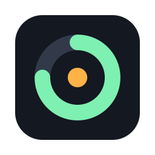
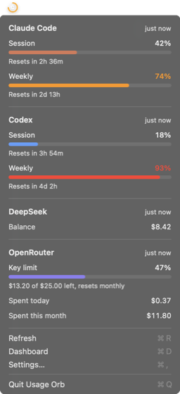

<p align="center"></p>

# Usage Orb

A small ring in your macOS menu bar for each AI coding tool, showing how much of its quota you've used.

Click a ring for that provider's native menu, or open All Providers for Claude Code and Codex quota windows and reset times, an OpenRouter key limit, and DeepSeek and OpenRouter spend. A dashboard keeps the history. No account, no server, no analytics.

[MIT license](LICENSE) · [Privacy](docs/PRIVACY.md) · [Plan](docs/PLAN.md) · [Testing](docs/TESTING.md)

**macOS 14 Sonoma or later · Swift + AppKit + SwiftUI + Swift Charts · no dependencies**

<p align="center"></p>

## Status

Early development: a working local MVP. No signed build is published yet, so build it yourself.

## The rings

Each connected provider gets its own ring with the provider's logo inside (Codex uses the OpenAI mark). A ring shows that provider's most used quota window. ⌘-drag to reorder them.

| Ring | Meaning |
| --- | --- |
| Monochrome arc | Below the warning threshold (70% by default) |
| Orange arc | At or above the warning threshold |
| Filled red circle | At or above the critical threshold (90% by default) |
| Faded arc on a dashed track | Stale: not measured recently |
| Dashed circle | Unknown: nothing measured yet |

OpenRouter gets a ring only when its key has a spend limit, because that's a real ceiling. DeepSeek reports only a balance, which has none, so it appears in the menu without a ring. Hover a ring, or use VoiceOver, for the window, reset time and when it was measured. Hover a row in the menu to see where the number comes from.

## Providers

| Provider | What it shows | How | Reliability |
| --- | --- | --- | --- |
| Claude Code | Session (5 h) and weekly quota windows, extra usage spend | Reads Claude Code's sign-in from your Keychain (macOS asks you first) and calls the endpoint behind Claude Code's `/usage` | **Undocumented endpoint.** May change without notice. Usage Orb never refreshes the token; if it has expired, run Claude Code once |
| Codex | Session (5 h) and weekly quota windows, credits | Reads the newest `rate_limits` event Codex CLI wrote to `~/.codex/sessions` (or `$CODEX_HOME`) | **Local log.** As fresh as your last Codex turn on this Mac; shown as stale after an hour |
| DeepSeek | Balance | `GET /user/balance` with your API key | Official API |
| OpenRouter | Key limit used, spend today and this month | `GET /api/v1/key` with your API key | Official API. Days are UTC |

Usage Orb never scrapes browser sessions.

Codex is on by default because it only reads local files. Claude Code waits until you choose it under **Add Provider**, because macOS will ask whether Usage Orb may read Claude Code's Keychain item. Choose **Always Allow** to avoid being asked again (ad hoc builds may ask again after each rebuild).

## Build and run

Install Xcode 15 or later. Optionally install [XcodeGen](https://github.com/yonaskolb/XcodeGen) (`brew install xcodegen`); the scripts regenerate the project when it is available.

```sh
./scripts/test.sh    # XCTest, ad hoc signed
./scripts/build.sh   # unsigned universal Release build → build/Build/Products/Release/UsageOrb.app
open UsageOrb.xcodeproj
```

For UI work without real accounts:

```sh
USAGE_ORB_SAMPLE=1 USAGE_ORB_OPEN=menu build/Build/Products/Debug/UsageOrb.app/Contents/MacOS/UsageOrb
```

`USAGE_ORB_OPEN` also accepts `dashboard` and `settings`. Sample mode keeps its own preferences and never reads accounts.

## Use

- **Click** a ring for its provider's card, then All Providers (every card), Add Provider, Refresh (⌘R), Dashboard (⌘D), Settings (⌘,) and Quit.
- **Settings** turns providers on and off, stores API keys in the Keychain, and sets the warning and critical thresholds, percentages next to the rings, the refresh interval (5 minutes by default) and Open at login.
- **Dashboard** charts quota use, daily OpenRouter spend and balances over a day to 90 days, from history kept on your Mac.

Failures back off (up to 8× the refresh interval) and the last good reading stays visible.

## Logos

Provider logos come from [Simple Icons](https://simpleicons.org) (CC0). They are trademarks of Anthropic, OpenAI, DeepSeek and OpenRouter, used only to identify each service. Usage Orb is not affiliated with or endorsed by any of them.

## Prior art

[CodexBar](https://github.com/steipete/CodexBar) is a mature menu bar app in the same space and worth a look. Usage Orb is a much smaller, independent take, about 1,600 lines with no dependencies.
