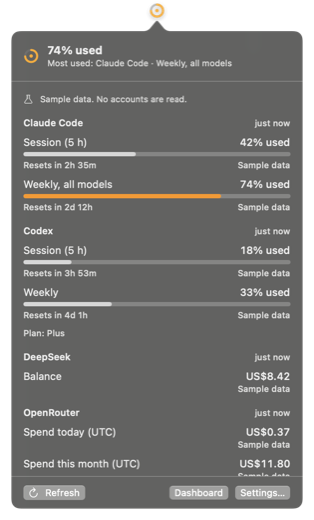

<p align="center"></p>

# Usage Orb

A tiny ring in your macOS menu bar that shows how much of your AI coding quota you've used.

Click it for a compact list of Claude Code and Codex quota windows with reset countdowns, plus DeepSeek and OpenRouter balances and spend. A dashboard keeps the history. No account, no server, no analytics.

[MIT license](LICENSE) · [Privacy](docs/PRIVACY.md) · [Plan](docs/PLAN.md) · [Testing](docs/TESTING.md)

**macOS 14 Sonoma or later · Swift + AppKit + SwiftUI + Swift Charts · no dependencies**

<p align="center"></p>

## Status

Early development: a working local MVP. No signed build is published yet, so build it yourself.

## What the ring means

By default the ring shows the **most used subscription quota window** among the providers you've connected: for example Claude Code's weekly limit at 74%. You can pin one window instead (Settings, or right-click a row in the popover).

| Ring | Meaning |
| --- | --- |
| Monochrome arc | Below the warning threshold (70% by default) |
| Orange arc with a dot | At or above the warning threshold |
| Red arc with a filled centre | At or above the critical threshold (90% by default) |
| Faded arc on a dashed track | The value is stale: it hasn't been measured recently |
| Dashed circle | Unknown: nothing comparable has been measured |

Balances and spend never drive the ring, because they have no fixed ceiling to take a percentage of. Hover the ring, or use VoiceOver, for the provider, window, reset time and when it was measured.

## Providers

| Provider | What it shows | How | Reliability |
| --- | --- | --- | --- |
| Claude Code | Session (5 h) and weekly quota windows, extra usage spend | Reads Claude Code's sign-in from your Keychain (macOS asks you first) and calls the endpoint behind Claude Code's `/usage` | **Undocumented endpoint.** May change without notice. Usage Orb never refreshes the token; if it has expired, run Claude Code once |
| Codex | Session (5 h) and weekly quota windows, credits | Reads the newest `rate_limits` event Codex CLI wrote to `~/.codex/sessions` (or `$CODEX_HOME`) | **Local log.** As fresh as your last Codex turn on this Mac; shown as stale after an hour |
| DeepSeek | Balance | `GET /user/balance` with your API key | Official API |
| OpenRouter | Spend today, this week, this month and all time; remaining key limit | `GET /api/v1/key` with your API key | Official API. Days are UTC |

Every figure in the app is labelled with its source. Usage Orb never scrapes browser sessions.

Codex is on by default because it only reads local files. Claude Code waits until you press **Connect**, because macOS will ask whether Usage Orb may read Claude Code's Keychain item. Choose **Always Allow** to avoid being asked again (ad hoc builds may ask again after each rebuild).

## Build and run

Install Xcode 15 or later. Optionally install [XcodeGen](https://github.com/yonaskolb/XcodeGen) (`brew install xcodegen`); the scripts regenerate the project when it is available.

```sh
./scripts/test.sh    # XCTest, ad hoc signed
./scripts/build.sh   # unsigned universal Release build → build/Build/Products/Release/UsageOrb.app
open UsageOrb.xcodeproj
```

For UI work without real accounts:

```sh
USAGE_ORB_SAMPLE=1 USAGE_ORB_OPEN=popover build/Build/Products/Debug/UsageOrb.app/Contents/MacOS/UsageOrb
```

`USAGE_ORB_OPEN` also accepts `dashboard` and `settings`. Sample mode keeps its own preferences and never reads accounts.

## Use

- **Click** the ring for the list. **Right-click** for Refresh, Dashboard, Settings and Quit.
- **Settings** turns providers on and off, stores API keys in the Keychain, chooses what the ring shows, sets the warning and critical thresholds, the refresh interval (5 minutes by default) and Open at login.
- **Dashboard** charts quota use, daily OpenRouter spend and balances over 24 hours to 90 days, from history kept on your Mac.

Failures back off (up to 8× the refresh interval) and the last good reading stays visible, labelled.

## Prior art

[CodexBar](https://github.com/steipete/CodexBar) is a mature menu bar app in the same space and worth a look. Usage Orb is a smaller, independent take built around one glanceable ring and strict labelling of where each number comes from.
